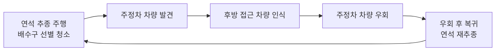
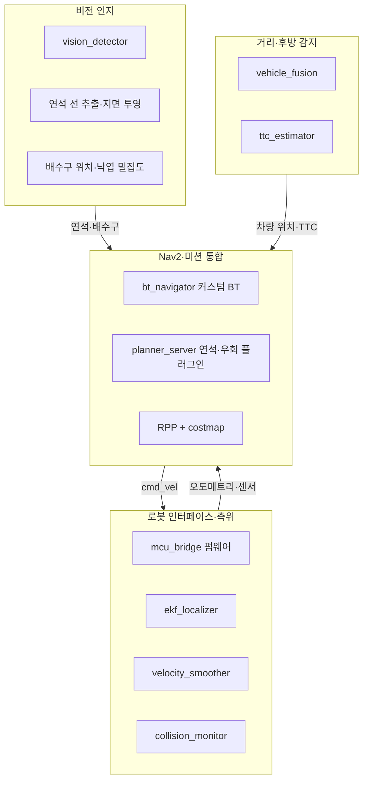

# 측구 주행 기반 우수 유입구 선별 청소 및 능동 차량 회피 모바일 로봇

> 2026 Pre-Capstone Design | 문의현 · 박태현 · 양예인 · 최현수

도로 가장자리 **측구(연석 옆)를 따라 자율주행**하며 낙엽·이물질로 막힌 **빗물받이(우수 유입구)를 선별해 청소**하고, 주정차 차량과 후방 접근 차량을 **능동적으로 회피**하는 모바일 로봇입니다.

---

## 1. 프로젝트 배경

### 문제 인식
- 낙엽과 이물질로 배수로가 막히면 도로 침수 위험이 커집니다.
- 2023년 안전신문고에 접수된 빗물받이 막힘 신고는 **14,206건**입니다.
- 호우 전·중에는 신속한 배수로 확보가 필요합니다.

### 기존 방식의 한계
| 방식 | 한계 |
| --- | --- |
| 대형 노면 청소차 | 차선을 점유해 교통 흐름을 방해하고, 도로 전반 청결이 목적이라 신속한 배수로 확보에 부적합 |
| 인력 투입 | 교통사고 등 안전 문제에 노출, 관리 대상이 방대함 (서울시 빗물받이 약 58만 개, 2024년 기준) |

### 해결 방안
1. **측구 주행**: 배수구는 차량 주행 공간과 구분된 도로 가장자리에 있으므로, 교통 흐름을 방해하지 않고 접근할 수 있습니다.
2. **배수구 선별 청소**: 청소가 필요한 배수구만 골라 청소해 신속하게 배수로를 확보합니다.
3. **무인 자동화 작업**: 연석 추종 주행과 주정차 차량 회피로 현장 인력의 도로 노출을 최소화합니다.

---

## 2. 전체 작동 흐름



---

## 3. 하드웨어

### 주행부 (Mobility System)
- 차체 크기 약 80cm × 77cm 규모의 주행 플랫폼

### 청소 작업부 (Cleaning System)
- 브러시를 회전시켜 낙엽을 포집
- 낙엽은 가이드를 따라 저장부로 이송
- 가이드를 개방해 저장부를 분리, 낙엽을 배출

---

## 4. 시스템 아키텍처 (블록 구성)



| 블록 | 역할 | 핵심 구성 |
| --- | --- | --- |
| 로봇 인터페이스·측위 | 주행, 센서 수신 | MCU 펌웨어, 센서 융합 측위, 속도 평활화, 충돌 감시 |
| 비전 인지 | 연석 인지, 작업 환경 판단 | 객체 검출, 연석 선 추출, 배수구·낙엽 밀집도 추정 |
| 거리·후방 감지 | 장애물 인지, 회피 판단 입력 | LiDAR-카메라 융합, 후방 TTC 추정 |
| Nav2·미션 통합 | 회피·작업 판단, 전체 통합 | 커스텀 Behavior Tree, 연석·우회 경로 플러그인 |

---

## 5. 팀원 및 역할

| 이름 | 담당 | 주요 업무 |
| --- | --- | --- |
| **양예인** | 로봇 인터페이스·측위 | `mcu_bridge` 펌웨어(엔코더, IMU, 모터 PID, 워치독, micro-ROS), `brush_driver`, `teleop_keyboard`, URDF·센서 TF, 시뮬레이션 환경, `ekf_localizer`·`velocity_smoother`·`collision_monitor` 설정, 전장 배선 |
| **박태현** | 비전 인지 | `vision_detector` 데이터 수집·라벨링·학습, 연석 선 추출과 지면 투영, 배수구 위치와 낙엽 밀집도 추정, 주행부 하드웨어 설계·제작 |
| **문의현** | 거리·후방 감지 | `vehicle_fusion`(LiDAR와 차량 박스 결합), `ttc_estimator`(후방 TTC), 카메라·LiDAR 캘리브레이션, 청소 작업부 하드웨어 설계·제작 |
| **최현수** | Nav2·미션 통합 | `bt_navigator` 커스텀 BT, `planner_server` 연석·우회 플러그인, RPP와 costmap 튜닝, 자동 주행 launch, 통합 총괄, 전장 배선 |

---

## 6. 사용 기술

| 분류 | 기술 |
| --- | --- |
| 로봇 미들웨어 | ROS 2, micro-ROS |
| 자율주행 | Nav2 (Behavior Tree Navigator, Planner Server, Regulated Pure Pursuit, Costmap) |
| 측위·제어 | EKF 기반 센서 융합(엔코더 + IMU), 모터 PID 제어, Velocity Smoother, Collision Monitor |
| 인지 | 딥러닝 기반 객체 검출(데이터 수집·라벨링·학습), 연석 선 추출 및 지면 투영, LiDAR-카메라 융합, TTC 추정 |
| 센서 | 카메라, LiDAR, IMU, 엔코더 |
| 임베디드 | MCU 펌웨어, 워치독 |
| 모델링·시뮬레이션 | URDF, TF, 시뮬레이션 환경 |
| 기계 설계 | 주행부·청소 작업부(브러시, 가이드, 탈착식 저장부) 설계·제작 |

---

## 7. 기대 효과

- **확장성**: 지자체 스마트 시티 환경 미화 사업(B2G)으로 연결 가능, 삼성 휴먼테크·한이음 등 공모전 출품 계획
- **실무 역량**: 인지–판단–제어–하드웨어를 아우르는 시스템 통합 및 Full Stack Robotics 경험

---

## 8. 저장소 구조

> 저장소 구성에 맞게 수정해 주세요.

```text
.
├── firmware/        # mcu_bridge (micro-ROS)
├── perception/      # vision_detector, 연석·배수구 인지
├── detection/       # vehicle_fusion, ttc_estimator
├── navigation/      # Nav2 BT, 플러그인, 파라미터
├── description/     # URDF, TF
├── hardware/        # 주행부·작업부 설계 파일
└── docs/
```
