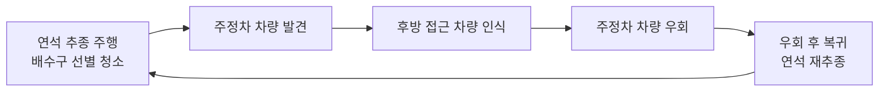
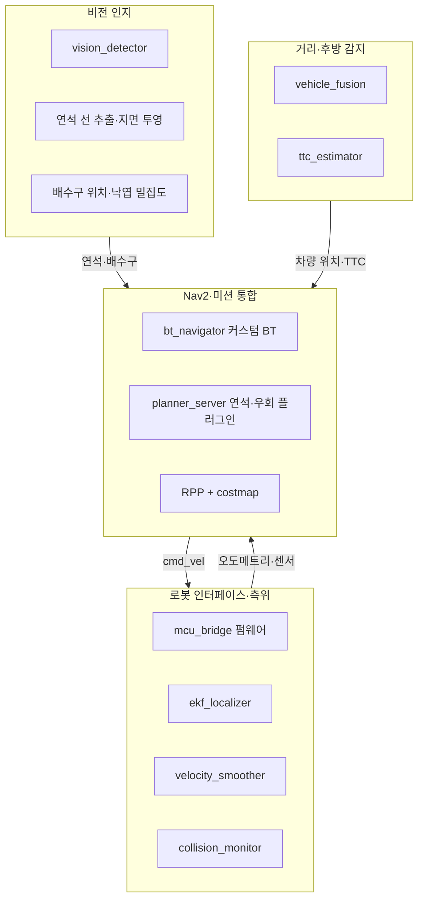

# 🚧 측구 주행 기반 우수 유입구 선별 청소 및 능동 차량 회피 모바일 로봇

> 한 줄 소개: 도로 측구를 따라 자율주행하며 막힌 빗물받이를 골라 청소하고, 주정차·접근 차량을 능동적으로 회피하는 모바일 로봇


**과목:** Pre-Capstone Design | **학기:** 2026 | **담당 교수:** 이승제

---

## 📑 목차

1. [주제 개요](#-주제-개요)
2. [팀원 소개](#-팀원-소개)
3. [문제 정의 및 목표](#-문제-정의-및-목표)
4. [시스템 구성](#-시스템-구성)
5. [사용 기술](#-사용-기술)
6. [기대 효과](#-기대-효과)
7. [프로젝트 일정](#-프로젝트-일정)
8. [실행 방법](#-실행-방법)
9. [참고 문헌](#-참고-문헌)

---

## 💡 주제 개요

낙엽과 이물질로 막힌 빗물받이는 도로 침수의 원인이 됩니다. 본 프로젝트는 차량 주행 공간과 분리된 **도로 가장자리 측구**를 따라 이동하며 **청소가 필요한 배수구만 선별해 청소**하는 무인 로봇을 개발합니다. 주정차 차량을 만나면 후방 접근 차량을 확인한 뒤 우회하고, 이후 다시 연석을 따라 복귀합니다.

- **주제:** 측구 주행 기반 우수 유입구 선별 청소 및 능동 차량 회피 모바일 로봇
- **분야:** 자율주행 모바일 로봇 / 비전 인지 / 센서 융합 / 시스템 통합
- **핵심 아이디어:** 측구 주행 + 선별 청소 + 무인 자동화
- **기대 효과:** 교통 흐름을 방해하지 않는 신속한 배수로 확보, 현장 인력의 도로 노출 최소화

<!-- 대표 이미지 또는 시연 GIF를 넣을 자리 -->
<!--  -->

---

## 👥 팀원 소개

이름을 누르면 GitHub 페이지로 이동합니다.

| 이름 | 학번 | 역할 | 담당 업무 |
|:---:|:---:|:---:|:---|
| [양예인](https://github.com/username1) | 20XXXXXXXX | 로봇 인터페이스·측위 (팀장) | `mcu_bridge` 펌웨어(엔코더, IMU, 모터 PID, 워치독, micro-ROS), `brush_driver`, `teleop_keyboard`, URDF·센서 TF, 시뮬레이션 환경, `ekf_localizer`·`velocity_smoother`·`collision_monitor` 설정, 전장 배선 |
| [박태현](https://github.com/username2) | 20XXXXXXXX | 비전 인지 | `vision_detector` 데이터 수집·라벨링·학습, 연석 선 추출과 지면 투영, 배수구 위치와 낙엽 밀집도 추정, 주행부 하드웨어 설계·제작 |
| [문의현](https://github.com/username3) | 20XXXXXXXX | 거리·후방 감지 | `vehicle_fusion`(LiDAR와 차량 박스 결합), `ttc_estimator`(후방 TTC), 카메라·LiDAR 캘리브레이션, 청소 작업부 하드웨어 설계·제작 |
| [최현수](https://github.com/username4) | 20XXXXXXXX | Nav2·미션 통합  | `bt_navigator` 커스텀 BT, `planner_server` 연석·우회 플러그인, RPP와 costmap 튜닝, 자동 주행 launch, 통합 총괄, 전장 배선 |

---

## 🎯 문제 정의 및 목표

### 배경 및 동기
- 2023년 안전신문고에 접수된 빗물받이 막힘 신고는 **14,206건**이며, 정부·지자체도 이를 도시 침수 예방의 주요 관리 대상으로 인식하고 있습니다.
- **대형 노면 청소차**는 차선을 점유해 교통 흐름을 방해하고, 도로 전반의 청결이 주목적이라 신속한 배수로 확보에 부적합합니다.
- **인력 투입**은 교통사고 등 안전 문제에 노출되며, 서울시 빗물받이만 약 58만 개(2024년 기준)로 관리 대상이 방대합니다.

### 문제 정의
- **입력:** 카메라·LiDAR·IMU·엔코더 센서 데이터
- **출력:** 연석 추종 주행, 배수구 선별 청소 동작, 차량 회피 경로 및 복귀

### 목표
- [ ] 연석을 따라 주행하며 청소가 필요한 배수구를 선별해 청소
- [ ] 주정차 차량 발견 시 후방 접근 차량(TTC)을 고려해 안전하게 우회
- [ ] 우회 후 연석으로 복귀해 재추종
- [ ] 현장 인력 개입 없는 무인 자동화 작업 수행

---

## 🏗 시스템 구성

### 전체 작동 흐름



### 소프트웨어 블록



| 블록 | 담당 | 역할 |
|:---|:---:|:---|
| 로봇 인터페이스·측위 | 양예인 | 주행, 센서 수신 |
| 비전 인지 | 박태현 | 연석 인지, 작업 환경 판단 |
| 거리·후방 감지 | 문의현 | 장애물 인지, 회피 판단 입력 |
| Nav2·미션 통합 | 최현수 | 회피·작업 판단, 통합 총괄 |

### 하드웨어
- **주행부:** 차체 약 80cm × 77cm 규모의 주행 플랫폼 (담당: 박태현)
- **청소 작업부:** 브러시 회전으로 낙엽을 포집 → 가이드를 따라 저장부로 이송 → 가이드를 개방해 저장부를 분리·배출 (담당: 문의현)

---

## 🧰 사용 기술

| 분류 | 기술 |
|:---|:---|
| 로봇 미들웨어 | ROS 2, micro-ROS |
| 자율주행 | Nav2 (BT Navigator, Planner Server, Regulated Pure Pursuit, Costmap) |
| 측위·제어 | EKF 센서 융합(엔코더 + IMU), 모터 PID, Velocity Smoother, Collision Monitor |
| 인지 | 딥러닝 객체 검출(데이터 수집·라벨링·학습), 연석 선 추출·지면 투영, LiDAR-카메라 융합, 후방 TTC 추정 |
| 센서 | 카메라, LiDAR, IMU, 엔코더 |
| 임베디드 | MCU 펌웨어, 워치독 |
| 모델링·시뮬레이션 | URDF, TF, 시뮬레이션 환경 |
| 기계 설계 | 주행부, 청소 작업부(브러시·가이드·탈착식 저장부) |

---

## 🌱 기대 효과

- **확장성:** 지자체 스마트 시티 환경 미화 사업(B2G 시장)과 연결 가능, 삼성 휴먼테크·한이음 등 공모전 출품 계획
- **실무 역량:** 인지–판단–제어–하드웨어를 아우르는 시스템 통합, Full Stack Robotics Engineer 역량 강화

---

## 📅 프로젝트 일정

| 단계 | 내용 | 상태 |
|:---:|:---|:---:|
| 1차 심사 | 문제 정의 및 시스템 설계 발표 | ✅ |
| TBD | 하드웨어 제작 | ⬜ |
| TBD | 인지·감지 모듈 개발 | ⬜ |
| TBD | Nav2 통합 및 시뮬레이션 | ⬜ |
| TBD | 실환경 시험 및 성능 개선 | ⬜ |
| TBD | 최종 발표 | ⬜ |

---

## ⚙️ 실행 방법

> 저장소 구성에 맞게 수정해 주세요.

### 환경 설정
```bash
git clone https://github.com/your-team/your-repo.git
cd your-repo
rosdep install --from-paths src --ignore-src -y
colcon build --symlink-install
source install/setup.bash
```

### 실행
```bash
# 시뮬레이션
ros2 launch <package> simulation.launch.py

# 자동 주행
ros2 launch <package> autonomous.launch.py
```

### 디렉터리 구조
```
.
├── assets/        # README용 이미지
├── firmware/      # mcu_bridge (micro-ROS)
├── src/           # ROS 2 패키지 (perception, detection, navigation, description)
├── hardware/      # 주행부·작업부 설계 파일
└── README.md
```

---

## 📚 참고 문헌

1. 저자, "논문 제목", 학회/저널, 연도. [[링크]](https://)
2. 저자, "논문 제목", 학회/저널, 연도. [[링크]](https://)

---

<p align="center">Pre-Capstone Design · 2026</p>
